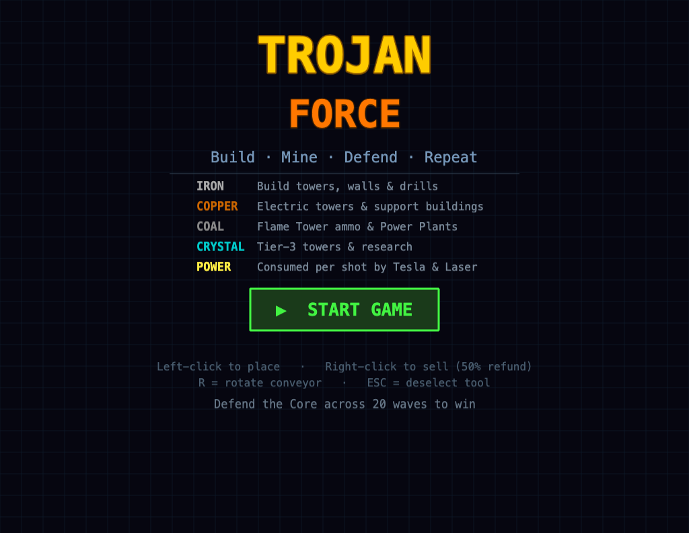
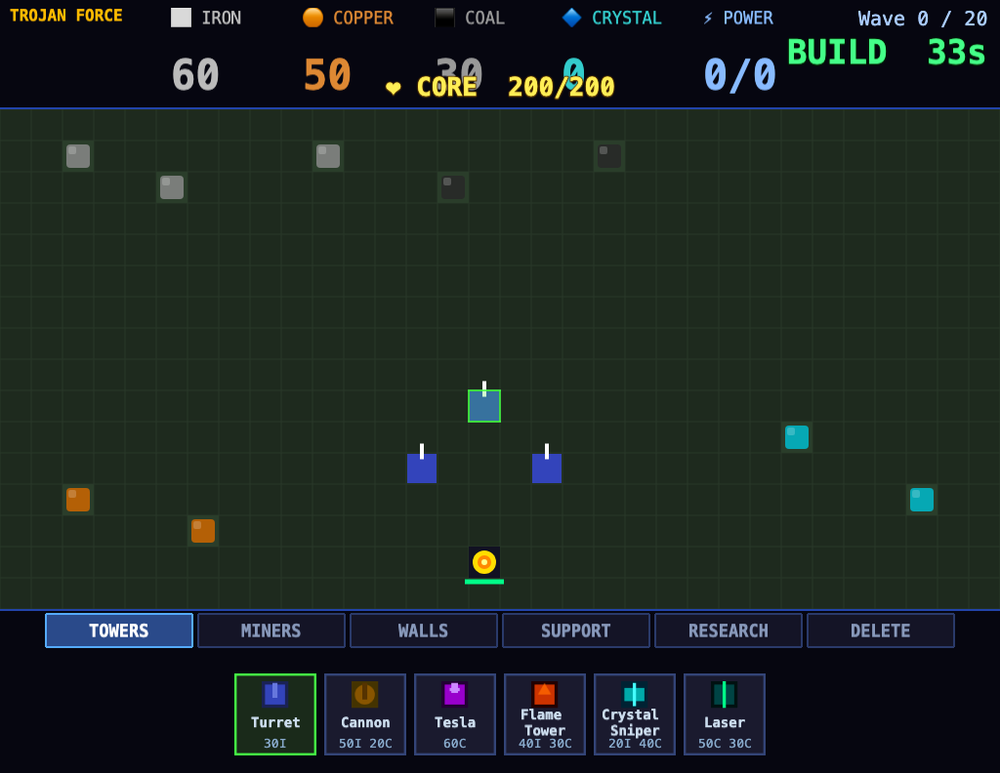
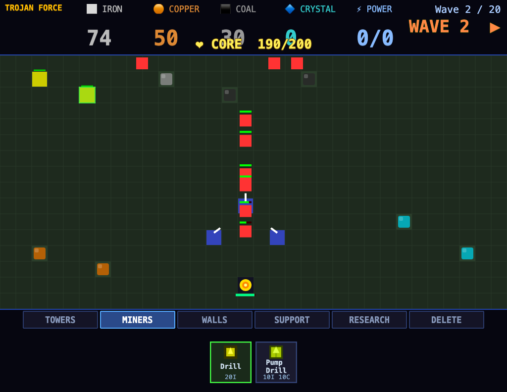

# Trojan Force

A browser tower defense game with a small factory layer. You mine resources, spend them on towers, walls and support buildings, and hold off 20 waves of enemies that path toward your Core. Built with Phaser 3, TypeScript and Vite. It runs entirely in the browser with no backend and no image assets: every texture is drawn in code at startup.

It exists as a compact, readable example of a resource-driven tower defense: towers that burn ammo and power from your stockpile, walls that reshape enemy paths, and a research tree that unlocks upgrades.







---

## Getting Started

Requires Node.js and npm.

```bash
# 1. Clone and enter the repo
git clone https://github.com/ReadableCode/Trojan-Force.git
cd Trojan-Force

# 2. Install dependencies
npm install

# 3. Start the dev server
npm run dev
```

The game opens at **http://localhost:3000** (the dev server opens a browser tab automatically).

---

## Play on Other Devices (Local Network)

To let phones, tablets, or other laptops on the same Wi-Fi join the game:

```bash
npm run dev -- --host
```

Vite will print two URLs:

```
  Local:   http://localhost:3000/
  Network: http://<your-lan-ip>:3000/
```

Any device on the same network can open the **Network URL** in a browser, no install needed. If other devices can't connect, check that your firewall allows inbound connections on port 3000.

This is the only multi-device hosting option covered here. There is no cloud or online deployment: you run the server on your machine. Each browser runs its own independent single-player game.

---

## How to Play

### Core Loop

Each round has two phases that repeat for 20 waves:

1. **Build Phase (45 seconds)**: Place miners on resource patches to gather Iron, Copper, Coal, and Crystal. Spend resources on towers, walls, and support buildings to fortify your defenses.
2. **Wave Phase**: Enemies spawn along one map edge (top for early waves, then alternating left, top and right) and advance toward your Core. Towers fire automatically. Destroyed enemies drop resources. The next build phase starts once every enemy in the wave is dead. Enemy HP grows 15% per wave.

Survive all 20 waves to win; if the Core (200 HP) reaches 0 you lose. Either way you get a score based on waves reached, resources spent and Core HP left.

You start with 150 Iron, 50 Copper and 30 Coal. Each resource patch holds a finite amount and fades out when mined dry.

### Controls

| Action | Input |
|---|---|
| Choose a category | Click a toolbar tab: Towers, Miners, Walls, Support, Research, Delete |
| Place selected building | Left-click on grid (green highlight = valid tile) |
| Sell building (50% refund) | Right-click on placed building, or the Delete tool |
| Rotate conveyor | R |
| Deselect / cancel | Esc |

Hovering a toolbar button shows its cost and description.

### Resources

| Resource | Primary Use |
|---|---|
| Iron | Towers, walls, drills, ammo |
| Copper | Tesla, Laser, support buildings |
| Coal | Flame Tower ammo, Power Plants |
| Crystal | Crystal Sniper, Laser, Research Lab |
| Power | Consumed per shot by Tesla and Laser towers |

Ammo and Power are drawn from your shared stockpile, so a tower stops firing when its resource runs out.

### Towers

| Tower | Cost | Range | Notes |
|---|---|---|---|
| Turret | 30 Iron | 4 tiles | Fast, cheap, general purpose |
| Cannon | 50 Iron + 20 Copper | 5 tiles | Slow heavy shot, 1.5-tile splash; consumes 2 Iron ammo per shot |
| Tesla | 60 Copper | 3 tiles | Chains to 3 targets; consumes 5 Power per shot |
| Flame Tower | 40 Iron + 30 Coal | 2 tiles | Rapid fire + burn DOT; consumes 1 Coal ammo per shot |
| Crystal Sniper | 20 Iron + 40 Crystal | 9 tiles | Very high single-shot damage, slow fire rate |
| Laser | 50 Copper + 30 Crystal | 6 tiles | Pierces armor; consumes 2 Power per shot |

### Miners, Walls and Support

| Building | Cost | Notes |
|---|---|---|
| Drill | 20 Iron | Must sit on a resource patch; 2 units/sec |
| Pump Drill | 10 Iron + 10 Copper | 4 units/sec |
| Deep Miner | 40 Iron + 20 Crystal | 8 units/sec; appears after Deep Mining research |
| Wall | 5 Iron | 100 HP; blocks ground paths, enemies reroute or break through |
| Reinforced Wall | 5 Iron + 5 Copper | 300 HP |
| Conveyor | 3 Iron | Rotates with R |
| Ammo Cache | 10 Iron | Ammo buffer building |
| Power Plant | 30 Iron + 20 Coal | +50 Power capacity; 50 Power/sec while burning 1 Coal/sec |
| Solar Panel | 20 Copper + 10 Crystal | +20 Power capacity; 20 Power/sec, no fuel |
| Research Lab | 40 Iron + 20 Crystal | Required to buy research |

Towers and walls cannot go on resource patches; miners can only go on them.

### Research

With a Research Lab built, open the Research tab and spend Crystal. Effects apply instantly, including to buildings already placed.

| Research | Crystal | Effect |
|---|---|---|
| Drill Efficiency I | 20 | Drills output +25% |
| Drill Efficiency II | 60 | Drills output +50% cumulative (needs I) |
| Turret Range | 30 | All towers +1 range |
| Explosive Shells | 50 | Cannon splash radius +0.75 tiles |
| Power Grid | 40 | Tesla/Laser power cost -30% |
| Reinforced Walls | 25 | Walls gain +50 HP |
| Deep Mining | 80 | Unlocks Deep Miner (needs Drill Efficiency II) |
| Auto-Conveyor | 60 | Recorded as owned; no gameplay effect yet |

### Enemies

| Enemy | Notes |
|---|---|
| Crawler | Fast, low HP, basic attacker |
| Brute | Slow, high HP, 20% armor; pounds on adjacent walls |
| Burster | Explodes on death, area damage to enemies and buildings |
| Flyer | Fastest unit; ignores ground obstacles |
| Burrower | Tunnels (ignores walls), 10% armor |
| Armored Tank | Very high HP, 50% armor, heavy damage |
| Swarm Queen | Spawns 4 Crawlers on death |

---

## How It Works

- **Scenes.** `BootScene` draws all textures with Phaser graphics, then hands off to `MenuScene`. Starting a game runs `GameScene` (grid, entities, waves, build/fight phases) with `UIScene` overlaid as the HUD.
- **Events.** Scenes talk through a shared `EventBus` (resources changed, phase changed, wave started, Core hit, tooltips, game over).
- **Pathing.** `Pathfinder` runs BFS over the 32x16 grid from each spawn tile to the Core. Placing or losing a wall reroutes ground enemies. Flyers and Burrowers path straight through. If walls block every route, ground enemies take the direct route and attack the walls in the way.
- **Data-driven balance.** Stats for towers, enemies, buildings, waves, research and the map live in `src/data/`, so tuning is a matter of editing those tables.

---

## Project Layout

```
src/
├── main.ts              Entry point: creates the Phaser game and registers scenes
├── constants.ts         Tile size, canvas dimensions, core HP, build-phase timer
├── EventBus.ts          Global Phaser EventEmitter shared between scenes
├── Pathfinder.ts        BFS grid pathfinder for enemy routing
├── ResourceManager.ts   Resource store: balances, rates, add/spend helpers
├── data/
│   ├── enemies.ts       Stat definitions for all enemy types
│   ├── towers.ts        Stat definitions for all tower types
│   ├── buildings.ts     Definitions for walls, miners, and support buildings
│   ├── waves.ts         Per-wave enemy spawn lists
│   ├── mapData.ts       Tile map layout and resource-patch positions
│   └── research.ts      Research tree node definitions and unlock effects
├── entities/
│   ├── Enemy.ts         Enemy sprite: movement, pathfinding, damage, death
│   ├── Tower.ts         Tower sprite: targeting, shooting, ammo consumption
│   ├── Building.ts      Placeable building sprite (walls, miners, support)
│   └── Projectile.ts    Projectile sprite: travel, hit detection, splash
└── scenes/
    ├── BootScene.ts     Generates textures in code, then starts the menu
    ├── MenuScene.ts     Main menu
    ├── GameScene.ts     Core gameplay: grid, entities, waves, build/fight phases, tabbed toolbar, research
    └── UIScene.ts       HUD overlay: resource bars, wave counter, tooltips, game over screen
```

---

## Development

**Type-check without building:**

```bash
npx tsc --noEmit
```

**Production build:**

```bash
npm run build
```

Output goes to `dist/`. The result is a folder of static files that can be served by any web server or opened directly with a local file server (e.g. `npx serve dist`).

**Preview the production build locally:**

```bash
npm run preview
```
